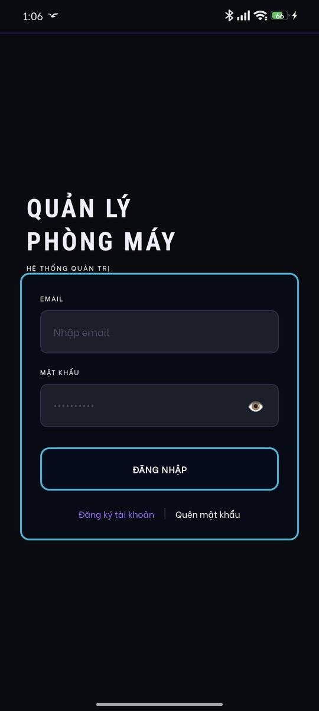
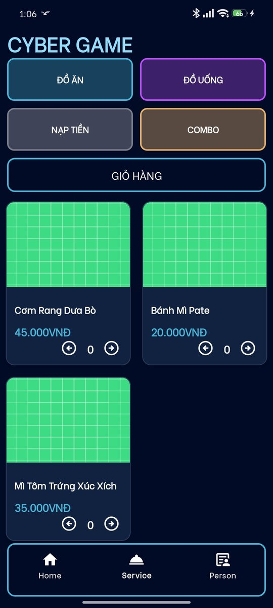
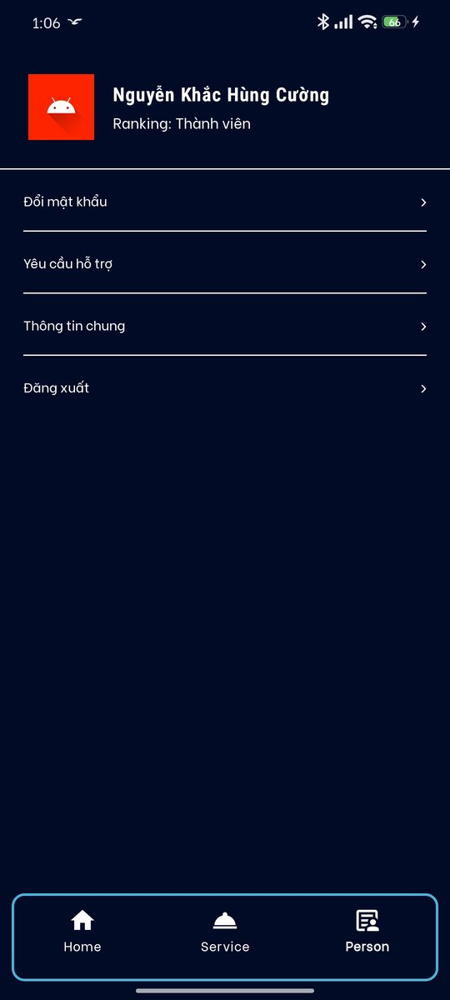
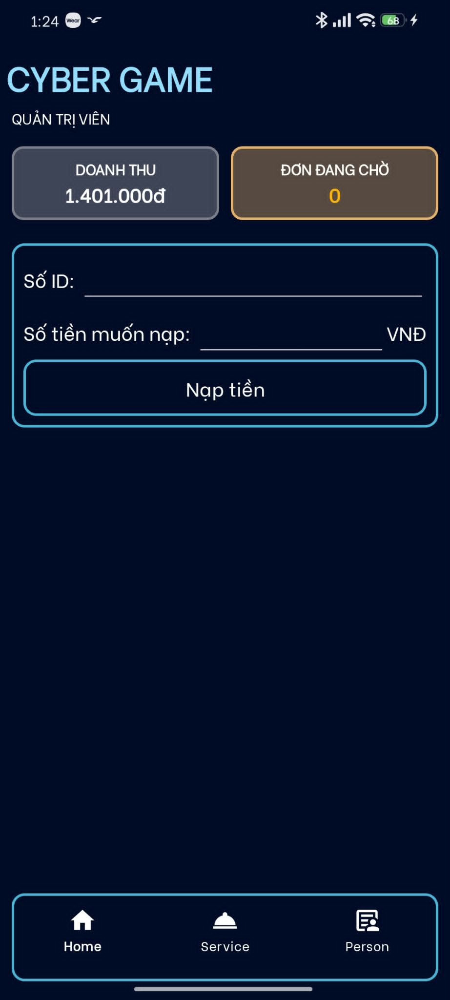

# Cyber Game – Ứng dụng quản lý quán net (Android)

Ứng dụng Android hỗ trợ vận hành quán net. **Người chơi** theo dõi thời gian và số tiền còn lại, đặt đồ ăn và mua giờ chơi. **Quản trị viên** nạp tiền, duyệt đơn, theo dõi doanh thu và hỗ trợ người chơi qua chat. Toàn bộ dữ liệu đồng bộ thời gian thực bằng Firebase.

## Demo

<p align="center">
  
  
  
  

&#x20; 
</p>
<p align="center"><em>Đăng nhập · Trang chủ người chơi · Menu dịch vụ · Trang cá nhân · Trang chủ quản trị viên</em></p>

## Tính năng

**Người chơi**

* Đăng ký, đăng nhập, quên mật khẩu, đổi mật khẩu (Firebase Authentication)
* Xem thời gian còn lại, số tiền còn lại và thời gian đã dùng, cập nhật theo thời gian thực
* Đặt đồ ăn, nước uống, combo và mua gói giờ chơi qua giỏ hàng
* Xem thông tin cá nhân, đổi tên hiển thị
* Chat hỗ trợ với quản trị viên

**Quản trị viên**

* Nạp tiền cho người chơi theo mã ID, tự quy đổi ra thời gian chơi (8.000đ = 60 phút)
* Xem và duyệt đơn đang chờ; đơn có gói giờ chơi được tự động cộng phút cho người đặt
* Theo dõi doanh thu
* Trả lời chat hỗ trợ của người chơi

Giao diện và chức năng hiển thị theo vai trò (`role`) của tài khoản: `user` hoặc `admin`.

## Công nghệ

* **Ngôn ngữ:** Java
* **Android:** minSdk 24, ViewPager2, BottomNavigationView, RecyclerView, BottomSheetDialog, Material Components
* **Backend:** Firebase Authentication, Firebase Realtime Database

## Điểm kỹ thuật

* **Cộng trừ an toàn:** tiền nạp, thời gian chơi và doanh thu đều được cập nhật bằng `ServerValue.increment()`, nên không bị mất dữ liệu khi nhiều thao tác diễn ra cùng lúc (ví dụ admin nạp tiền đúng lúc app đang trừ phút).
* **Một nguồn dữ liệu duy nhất:** thời gian còn lại (`remainingMinutes`) là dữ liệu gốc; số tiền còn lại được tính ra từ đó theo hằng số `PRICE\_PER\_HOUR`, nên hai con số không bao giờ lệch nhau.
* **Chống duyệt đơn hai lần:** nút duyệt bị khóa ngay sau khi bấm, tránh cộng giờ hai lần.
* **Firebase Security Rules:** chỉ người đã đăng nhập mới đọc và ghi được dữ liệu; người dùng không thể tự đổi `role` của mình thành `admin`.

## Cấu trúc dữ liệu trên Firebase

|Đường dẫn|Nội dung|
|-|-|
|`users/{uid}`|`fullName`, `phone`, `email`, `role` (`user` / `admin`), `userId` (mã 4 số dùng khi nạp tiền), `ranking`, `balance` (tổng tiền đã nạp), `remainingMinutes`, `usedMinutes`|
|`Products/{id}`|`name`, `price`, `category` (`food`, `drink`, `money`, `combo`)|
|`Orders/{id}`|`orderId`, `uid` (người đặt), `items`, `totalPrice`, `topupMinutes`, `status` (`pending` / `completed`)|
|`chats/{uid}/messages`|Tin nhắn hỗ trợ giữa người chơi và quản trị viên|
|`System/Revenue`|Tổng doanh thu|

## Cấu trúc mã nguồn

```
app/src/main/java/com/example/cyber\_game/
├── LoginActivity, RegisterActivity          # Đăng nhập, đăng ký
├── ForgotPasswordActivity, ChangePasswordActivity
├── MainActivity, ViewPagerAdapter           # 3 tab: Trang chủ, Dịch vụ, Cá nhân
├── fragment\_home                            # Trang chủ, hiển thị theo vai trò người chơi / admin
├── fragment\_service                         # Menu dịch vụ, giỏ hàng, đặt đơn
├── fragment\_person                          # Thông tin cá nhân, đổi tên, hỗ trợ
├── SupportChatActivity                      # Người chơi chat với admin
├── AdminSupportActivity, AdminChatActivity  # Admin xem danh sách và trả lời chat
├── ProductAdapter, CartAdapter, OrderAdapter, ChatAdapter
└── product, Order, ChatMessage              # Lớp dữ liệu
```

## Cài đặt

1. Clone repo và mở bằng Android Studio
2. Tạo project Firebase, bật **Authentication (Email/Password)** và **Realtime Database**
3. Tải file `google-services.json` của project đó vào thư mục `app/`
4. Chạy app, đăng ký một tài khoản rồi đổi `role` của tài khoản đó thành `admin` trong Firebase Console để có quyền quản trị

## Hạn chế và hướng phát triển

* Thời gian chơi đang được trừ bởi chính app trên điện thoại người chơi, nên chỉ bị trừ khi app đang mở. Trong thực tế, việc đếm giờ cần do máy trạm hoặc server (ví dụ Cloud Functions) đảm nhận, dựa trên thời điểm bắt đầu phiên chơi.
* Vì việc đếm giờ chạy trên điện thoại, Rules vẫn phải cho người chơi ghi vào thời gian chơi của chính mình; cần siết lại khi chuyển việc đếm giờ lên server.
* Mã `userId` 4 chữ số được tạo ngẫu nhiên, chưa kiểm tra trùng.
* Danh sách đơn chờ chưa hiển thị tên người đặt.
* Rút doanh thu chỉ đặt số về 0, chưa lưu lịch sử các lần rút.
* Một số listener của Firebase chưa được gỡ khi rời màn hình.
* Thống kê số người chơi và số máy hoạt động đã có giao diện nhưng chưa hoàn thiện.

## Tác giả

Nguyễn Khắc Hùng Cường – Sinh viên Kỹ thuật máy tính

